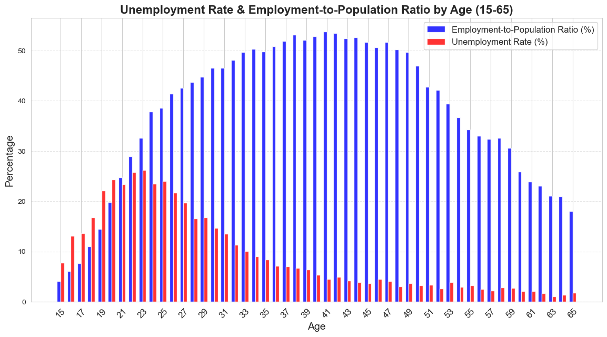
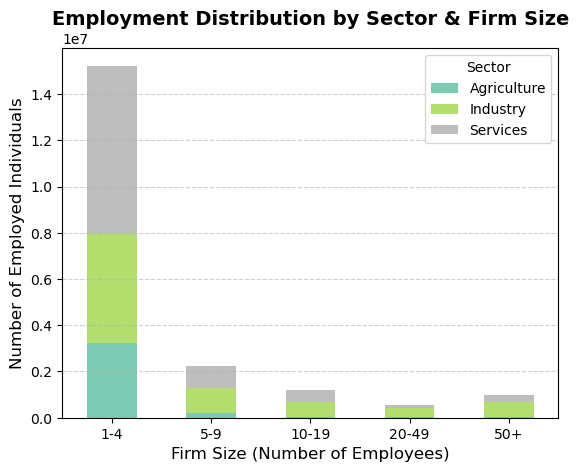

# Iran Labour Force Survey: Labour Market Indicators from Microdata

Cleaning and analysis of individual-level microdata from Iran's **Labour Force Survey (LFS)**, published by the Statistical Center of Iran. The notebook builds the standard labour-market indicators from the raw survey file and documents how they vary by gender, education, age, sector, firm size, occupation and social-insurance coverage.

<p align="center">
  
  
</p>

## What the notebook does

| Step | Content |
|---|---|
| **Data preparation** | Reads the raw `LFS_RawData` table from the Microsoft Access release, recodes activity status, education, ISIC industry and ISCO occupation codes, and builds analysis variables. |
| **Participation and unemployment** | Labour-force participation and unemployment rates by gender and by six education groups, using standard ILO definitions. |
| **Age profiles** | Unemployment rate and employment-to-population ratio by single year of age (15–65). |
| **Structure of employment** | Employment across agriculture, industry and services by establishment size (1–4, 5–9, 10–19, 20–49, 50+ employees). |
| **Working hours and informality** | Weekly hours by occupation and insurance status, with a one-way ANOVA testing differences in hours across groups. |

## Skills demonstrated

- Working with large official survey microdata in its raw release format
- Constructing labour-market indicators from first principles rather than published tables
- Working with international classification systems (ISIC, ISCO)
- Clear descriptive visualisation of labour-market structure

## Repository structure

```
LFS_Data_cleaning.ipynb   # full pipeline: cleaning → indicators → figures → ANOVA
figures/                  # selected figures exported from the notebook
```

## Reproducing

The LFS microdata are distributed by the [Statistical Center of Iran](https://www.amar.org.ir/) and are not included here.

```bash
pip install pandas numpy matplotlib scipy pyodbc
```

Place the `.mdb` release in a local folder, set the path in the first cell, and run all cells. Reading Access files through `pyodbc` requires the Microsoft Access ODBC driver (Windows) or `mdbtools` (Linux/macOS).

## Context

Developed during the MSc in Economics at Sharif University of Technology (Econometrics I).

---
**Shayan Pourmasoomi** · MSc Economics, Sharif University of Technology · [LinkedIn](https://www.linkedin.com/in/shayan-pourmasoomi-8b6206389)
